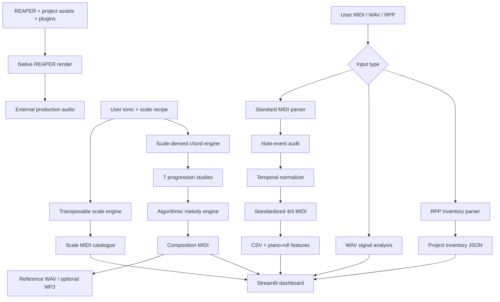

# Particula Primordial

**An auditable toolkit for computational music analysis, transposable scale studies and algorithmic composition.**

[](https://github.com/OWNER/REPOSITORY/actions/workflows/tests.yml)
[](https://www.python.org/)
[](LICENSE)

Particula Primordial turns a user-supplied MIDI performance into a reproducible musical data workflow. It can inspect MIDI note events, normalize onset timing to a configurable grid and uniform duration, generate a catalogue of transposed scales, create scale-derived extended-harmony studies and algorithmic melodies, and build an open-ended sustained study.

The selected tonic and scale are **parameters**. The same algorithms work with any supported 12-tone-equal-temperament tonic and any interval recipe in `particula/theory.py`.

> **Research boundary:** temporal normalization preserves pitch, channel and velocity. It does not silently correct wrong notes, infer a key, or claim that a single scale list covers every musical culture or tuning system.

## 1. Research and implementation scope

The repository has two deliberately separated execution modes:

| Mode | Runs where | Responsibilities |
|---|---|---|
| **Offline analysis** | Local Python, Google Colab or Streamlit Community Cloud | Standard MIDI parsing, note-event audit, 4/4 normalization, scale catalog generation, scale-derived harmony and melody, reference WAV/MP3 generation, WAV measurements, RPP track/item/media inventory |
| **REAPER-dependent rendering** | A computer with REAPER installed and the project's plugins/media available | Native arrangement playback and full project rendering using REAPER's saved project/render settings |

The `.RPP` parser is intentionally conservative: it inventories project settings, tracks, media items, source references and visible FX chunk labels. It is not a complete interpreter for every REAPER state chunk or plugin-private state. For note-level extraction from a selected REAPER MIDI take, use the included ReaScript exporter. For a native arrangement render, use REAPER itself.

## 2. Features

### MIDI analysis and normalization

- Reads Standard MIDI Files (`.mid`, `.midi`) with tick-based timing.
- Lists tracks and counts note events.
- Produces note-event tables with pitch, note name, velocity, channel, start beat, end beat and duration.
- Snaps note onsets to a user-selected beat grid.
- Applies a user-selected fixed note duration, or quantizes original durations.
- Writes a standardized **4/4** time signature and one constant target BPM.
- Keeps pitches, velocity and MIDI channel unchanged for the selected note track(s).
- Exports normalized MIDI and an audit CSV.

Normalization is a temporal transformation. If a recorded note has the wrong pitch, that remains an explicit musical decision rather than an automatic correction.

### Transposable scale catalogue

The current starter catalogue contains 21 interval recipes: major, natural minor, harmonic minor, ascending melodic minor, seven modes, major/minor pentatonic, major/minor blues, whole tone, two diminished collections, double harmonic major, Hungarian minor, Neapolitan minor, Phrygian dominant and chromatic.

A recipe is a sequence of semitone offsets from the tonic. Change the tonic and the same recipe is transposed. Add or edit recipes in `SCALES` to extend the catalogue. The current implementation assumes 12-TET; it does not model microtonal divisions or claim to enumerate every scale system worldwide.

### Computational composition

- Seven configurable four-chord progression templates.
- Chords built by stacking alternate degrees from the selected scale.
- Extended sonorities with 7th, 9th, 11th and 13th scale tones.
- Seven deterministic melodic contour methods: reflection, modular permutation, Fibonacci residues, prime residues, logistic map, bounded random walk and cyclic pendulum.
- Eight-bar MIDI studies with separate harmony and melody tracks.
- A sustained, extensible ascension study with an intentionally open ending.

For non-heptatonic scales, tertian stacks still use the scale's available degrees cyclically. Conventional chord labels can therefore be approximate; the MIDI pitches remain traceable to the selected interval recipe.

### Audio and signal measurements

The built-in renderer creates a simple additive reference tone from MIDI and writes WAV. It can create MP3 when FFmpeg is installed. This is a lightweight preview renderer, not a piano sample library, SoundFont performance, virtual instrument or final mix. The REAPER route is the production-render path.

WAV analysis reports duration, sample rate, channel count, peak, RMS, zero-crossing rate and a frame-averaged spectral-centroid estimate.

### REAPER project mode

- Parses `.RPP` text into an inventory of project tempo/time signature, tracks, items, positions, lengths, media source paths and visible FX chunk names.
- Provides `reaper_scripts/export_selected_midi_notes.lua` to export selected MIDI-take note events through REAPER's ReaScript API.
- Provides command-line wrappers for REAPER's `-renderproject` mode.

The project inventory does not prove that every referenced media file exists or that the project can render successfully. Plugin availability, licensing, routing, media paths and render settings remain host-machine concerns.

## 3. Architecture



### Repository layout

```text
particula-primordial/
├── app.py                         # Streamlit research dashboard
├── particula/
│   ├── theory.py                  # Tonic-independent interval recipes and chords
│   ├── midi_tools.py              # MIDI inspection and 4/4 normalizer
│   ├── composition.py             # Progression / melody / ascension generators
│   ├── audio.py                   # Reference synthesis and WAV measurements
│   ├── rpp.py                     # Conservative RPP inventory parser
│   ├── reaper_cli.py              # Local REAPER command-line wrapper
│   ├── features.py                # Musical summaries
│   └── exports.py                 # CSV / JSON outputs
├── reaper_scripts/
│   ├── export_selected_midi_notes.lua
│   ├── render_project_windows.bat
│   └── render_project_unix.sh
├── notebooks/                     # Google Colab starter notebook
├── docs/                          # Technical note, architecture and validation plan
├── tests/                         # Synthetic MIDI / RPP / audio tests
├── .github/workflows/tests.yml    # CI test workflow
├── requirements.txt
├── packages.txt                   # FFmpeg for hosted MP3 conversion
├── pyproject.toml
├── CITATION.cff
└── LICENSE
```

## 4. Run locally

Python 3.10 or newer is recommended.

```bash
git clone https://github.com/OWNER/particula-primordial.git
cd particula-primordial
python -m venv .venv
# Windows: .venv\Scripts\activate
# macOS/Linux:
source .venv/bin/activate
pip install -r requirements.txt
streamlit run app.py
```

For MP3 conversion, install FFmpeg and ensure `ffmpeg` is available on `PATH`. WAV reference rendering does not require FFmpeg.

Run tests:

```bash
python -m pytest -q
```

## 5. Deploy the dashboard

1. Create a GitHub repository named `particula-primordial`.
2. Upload or push the **contents** of this folder to the repository root.
3. Replace `OWNER` and `REPOSITORY` in the README badge and clone URL with your GitHub username and repository name.
3. Open [Streamlit Community Cloud](https://share.streamlit.io/).
4. Choose the repository, branch `main`, and entry point `app.py`.
5. Deploy. Community Cloud installs Python dependencies from `requirements.txt`; `packages.txt` requests FFmpeg for MP3 conversion.

The hosted dashboard can analyze uploaded files and create preview artifacts. It cannot access your local REAPER installation, plugin folders, local media paths or licensing state. Native REAPER rendering must run on a machine where those resources exist.

## 6. Google Colab

Upload `notebooks/Particula_Primordial_Colab.ipynb` to [Google Colab](https://colab.research.google.com/), run the cells and upload a source MIDI. Set `TONIC`, `SCALE_NAME`, `TARGET_BPM`, grid and note duration in the configuration cell. The notebook is a lightweight standalone entry point; the Streamlit app and `particula/` package contain the broader dashboard and analysis modules.

## 7. REAPER workflow

### Inventory

Upload an `.RPP` into the dashboard's **REAPER & audio** tab to produce a project inventory JSON.

### MIDI note export

1. Open the project in REAPER.
2. Select the MIDI media item(s) to inspect.
3. Run `reaper_scripts/export_selected_midi_notes.lua` from the Actions list.
4. The script writes `particula_primordial_midi_notes.csv` to REAPER's resource directory. It includes PPQ position, project-QN position, pitch, velocity, channel and mute state. Upload that CSV into the dashboard to inspect its note distribution and piano roll.

### Full arrangement render

REAPER renders with the project's saved render settings. On a machine with REAPER on `PATH`:

```bash
reaper -renderproject "/path/to/project.rpp"
```

Windows users can call `reaper_scripts/render_project_windows.bat`; macOS/Linux users can call `render_project_unix.sh`. Verify the render range, destination, format, sample rate and plugin availability in REAPER before running the command.

## 8. Validation and scientific limits

The test suite uses synthetic MIDI/RPP fixtures to verify deterministic transformations and core invariants. Passing software tests does not establish perceptual quality, transcription accuracy or musical superiority. See:

- [`docs/TECHNICAL_NOTE.md`](docs/TECHNICAL_NOTE.md)
- [`docs/VALIDATION_PROTOCOL.md`](docs/VALIDATION_PROTOCOL.md)
- [`docs/TEST_REPORT.md`](docs/TEST_REPORT.md)
- [`docs/DATA_DICTIONARY.md`](docs/DATA_DICTIONARY.md)

The paper is an academic-style technical note, not a peer-reviewed publication. Claims about musical usefulness and audio fidelity require listening tests and controlled evaluation with human-composed material.

## 9. Citation

If you use this software, cite the repository using [`CITATION.cff`](CITATION.cff). The accompanying technical note is included as PDF and Markdown in `docs/`.

## 10. License

MIT License. See [`LICENSE`](LICENSE).
